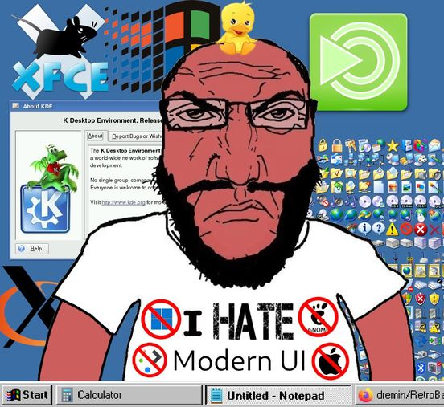

# Apoca-95

A BepInEx 5 plugin for Apocalypter that puts the game, and the mods around it, in the Windows 95 look of the
[Chicago95](https://github.com/grassmunk/Chicago95) desktop theme: grey bevelled windows, navy title bars, sunken
white fields, latched buttons, dithered scrollbars, and the desktop's own bitmap font, drawn pixel for pixel.

The game's menus, settings, loading screen, Tab screen and HUD are drawn anew from the game's own state. Other mods'
windows are patched at runtime; their DLLs are never changed. Every part is its own switch, and a mod's patch does
nothing when that mod isn't installed.

> **Early.** It has had little play outside the author's own game, with the author's own set of mods.

## The game

- **Title menu.** Continue, New Game (with the seed), Load Game, Settings, Mods and Quit in one window. Load Game
  lists the saves; quitting asks first.
- **Pause menu.** Continue, Save Game (the save slots, asking before overwriting), Settings, Codex, Tutorial,
  Credits, Mods and Quit to Main Menu. The status bar shows the distance travelled, or that the game is saving.
- **Settings.** One property sheet: Graphics (resolution, screen mode and quality as drop-down lists, applied with
  Apply), Audio, Controls, Gameplay, Player & Car and Cheats. Check boxes and trackbars apply at once.
- **Controls.** Every key that does anything, one category at a time, as a list view: the game's actions, the keys
  the game reads directly, every key setting of every mod, and keys hardcoded in mods (this list is Wild Wasteland's;
  the tab needs it). Click a key and press the new one; Backspace sets none, Esc cancels. Keys used twice are red,
  and choosing an action says what else uses its key.
- **Loading.** A dialog over the loading screen: what is loading, a block progress bar (the game's load stages, then
  the terrain generator's own progress), the details (the save file Easy Save is reading, how many keys it has read
  and which one now; the terrain's tiles as a grid: waiting, generating, drafted, finished), a DOS console with this
  machine, the loaded plugins and the log as it is written (Easy Save's files and MapMagic's tiles included), and a
  "Did you know..." tip when Wild Wasteland has one. Saving shows it too. It follows the game itself, so it works
  without Wild Wasteland.
- **Tab screen.** The player sheet as a window: equipment, the player's picture, ammunition, factions and warlords
  (their pictures change when they're killed), with the day and hour in the status bar. Read live from the game's
  own sheet.
- **HUD.** A taskbar along the bottom of the screen: health and armour as block progress bars, a taskbar button
  for each item and weapon slot (its key, icon, name and count; the drawn one latched down, empty ones greyed), and
  a tray with thirst, hunger, fatigue, insanity and radiation while the game shows them, ammunition, grenades, nuts,
  the heading, the day and a clock that tells the time in words ("quarter to three"). Each tray item keeps its
  width, so nothing jumps.

  It is read from the game's own HUD, so mods that change that change this: a mod that adds slots the way the game
  draws them (Apocapocket's 4 to 6) adds buttons, and the numbers are whatever the game's texts say. Items Apocapocket
  stores show their names too.

## Notifications

Every mod writes its messages on the HUD its own way. Here they all go to one place, as Windows tooltips (pale
yellow, black frame):

- **Notices** stack under the top of the screen for a few seconds; a repeat counts up instead of stacking. The
  game's timed messages, Apocalypter Quests' toasts, Wild Wasteland's "War rig spawned" and its template exporter,
  Immersive Map's toasts, Apocasaver's saving status and countdown, Engine Sim's notices.
- **Prompts** about what you aim at sit beside the crosshair, as a tooltip under a pointer: the item's name, its
  condition, contents, price or count on one line ("87%", "5.2 / 13L", "12 pcs"), its effects and what the use key
  does, a groove between each. Whoever writes them: the game, Ultimate Tools, Apocapocket, Burner's Utilities.
- **Instructions** sit in the top left corner while they apply: the game's part adjusting and weapon keys, Ultimate
  Tools' tool guide and suspension hint, Burner's Utilities' nail gun and rope tool, Engine Sim's tuning kit, Wild
  Wasteland's weapon pose and vehicle hotkey hints, Apoc-Air's cockpit readout.

Hints stay out of menus; notices show over them.

## Other mods

- **Apocasetter**: the Mods window as a 720 × 480 dialog (the mod list on the left, its settings, about, notes and
  files on tabbed pages, its drop-down lists as real drop-downs), its "Mods changed" / "N mod updates" notice as a
  window beside the title menu, and its Mods button.
- **Apocasaver**: the save name prompt as a Save Game dialog. Enter is OK, Esc is Cancel.
- **Apocaspawner**: its window at a whole-number scale, in the bitmap font, with a navy title bar, sunken panels,
  raised buttons, sunken white fields and the theme's scrollbars.
- **Wild Wasteland**: its windows (the F7 settings, which also open on a new game, and the patrol template menu and
  exporter) at a whole-number scale, so every line lands on a whole pixel, in the bitmap font, with Windows 95
  controls: the chosen one of a row of choices latched down, real check boxes and drop-down boxes, the theme's
  scrollbars. Its CleanHUD's vitals, weapon and slot panels make way for the taskbar; its compass and message log
  stay.
- **Engine Sim**: the Engine Tuning Toolkit, the dyno and its notices in the bitmap font, with the theme's title
  bars.

## The MS-DOS Prompt

The backquote key (`` ` ``) opens an MS-DOS Prompt window: a black 80-column screen in the VGA font. Backquote or Esc
closes it. While it is open the game keeps running, but its keys and mouse read as nothing, so typing doesn't walk
or fire.

- **The log**: BepInEx's warnings and errors as they come. `log all` shows everything, `log warn` goes back to
  warnings and errors, `log off` shows none.
- **Lua**: with SigmaMod 2.0, anything typed at `C:\APOCALYPTER>` runs as Lua in SigmaMod's console, one state for
  the session; an expression prints its value. `clr.type`, `clr.objects`, `clr.find`, `clr.component`, `clr.new`,
  `vec`, `print` and `log` reach the game's and mods' objects as they are, e.g.
  `g = clr.objects("DcGenerator")[1]` then `g.LoadText`. Without SigmaMod it answers "Bad command or file name".
- **Its own commands**: `cls`, `help`, `reset` (a fresh Lua state), `exit`.
- Up and Down step through what was typed; Page Up and Page Down scroll.

## Settings

In `BepInEx/config/com.burner.apocalypter.chicago95.cfg`, or in game through the Apocasetter Mods menu. Each needs a
restart.

| Setting | Default | |
|---|---|---|
| `Patches.TitleMenu` | on | The title screen's menu as a window. |
| `Patches.PauseMenu` | on | The pause menu as a window. |
| `Patches.LoadingScreen` | on | The loading and saving dialog. |
| `Patches.PlayerSheet` | on | The Tab screen as a window. |
| `Patches.Hud` | on | The HUD as a taskbar. |
| `Patches.Notifications` | on | Mods' HUD messages and hints as tooltips, and the HUD's prompts and instructions. |
| `Patches.Apocasetter` | on | The Mods window, its notice and button. |
| `Patches.WildWasteland` | on | Wild Wasteland's windows. |
| `Patches.EngineSim` | on | Engine Sim's windows. |
| `Patches.Apocaspawner` | on | Apocaspawner's window. |
| `Patches.Console` | on | The MS-DOS Prompt on the backquote key. Restart to apply. |

## Requirements

BepInEx 5. Everything else is optional: Wild Wasteland (0.1.11), Apocasetter (2.1.1), Apocasaver, Engine Sim,
Apocaspawner, Apocapocket, Ultimate Tools, Burner's Utilities, Apocalypter Quests, Immersive Map and Apoc-Air are each patched
when they're there. SigmaMod 2.0 gives the MS-DOS Prompt its Lua. Other versions of them may leave their patch off; the log says which, and the rest keeps working.

## Install

Unzip the release into `Apocalypter/BepInEx/plugins`, so that `BepInEx/plugins/Apoca-95/Chicago95.dll` exists.

## Build

`dotnet build -c Release` in this folder, with the folder inside the game's folder (or `-p:GameDir=<the game's
folder>`). It builds against the game's own assemblies and BepInEx, plus the two mods whose types it uses, which go
in `lib/`: `WildWasteland.dll` (0.1.11) and `Apocasetter.dll` (2.1.1). The build copies the DLL to
`BepInEx/plugins/Apoca-95`.

The fonts are atlases baked from bitmap fonts by `tools/make_font.py` (Python with Pillow).

## Credits

- The look is the [Chicago95](https://github.com/grassmunk/Chicago95) theme by grassmunk.
- Text is Cronyx Helvetica (Cronyx Ltd., from the X11 Cyrillic fonts), the 11 px strike Chicago95 shows as
  "Helvetica 8".
- The console is More Perfect DOS VGA, after Zeh Fernando's Perfect DOS VGA 437.

## License

MIT, see `LICENSE`.
